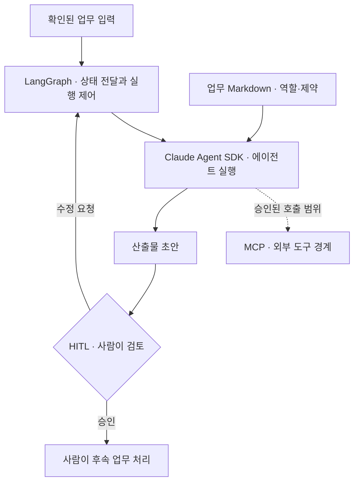

# The First · HR Onboarding

## 1. 프로젝트 소개

입사 전후에는 HR, 리더, 준비 담당자가 서로 다른 작업을 맡는다. 계획, 안내문, 준비 요청, 수정 요청이 따로 움직이면 누가 무엇을 준비했고 어느 결과를 검토했는지 파악하기 어렵다. The First는 이 과정을 계획부터 검토까지 연결하고, 담당자가 확인할 수 있는 초안을 만드는 HR 에이전트를 개발한다. 이는 프로젝트가 해결하려는 문제의 설명이며, 고객사의 실제 절차와 사례는 샘플 및 업무 담당자 확인이 필요하다. 제출 기한은 **2026-12-03 23:59 KST**다.

## 2. 프로젝트 목표 및 범위

목표 기능은 온보딩 계획과 진행 관리, 안내 메일·리더 체크리스트·담당자 준비 요청 초안, 산출물 검토·수정 요청·사람 승인 상태 관리다. 현재는 개발 환경과 인증 없는 기술 smoke, 문서·권한·리뷰 기반을 제공한다. 업무 구현은 샘플 및 계약 확인 이후 진행한다.

실제 메일 발송과 입사 확정은 사람이 수행한다. 실제 고객사 자료 반입과 MCP 쓰기는 금지한다. 외부 실행은 명시 승인에 따른다. 프론트엔드와 FastAPI는 범위에서 제외한다. [범위와 근거](docs/project-scope.md)

## 3. 팀원별 담당 업무

아래 구현 경로와 산출물은 착수용 제안이다. 공통 모듈 소유권과 각 산출물의 형식은 팀에서 확인한다.

| 담당 | 목적과 구현할 기능 | 제안 위치와 예상 산출물 | 함께 결정할 사항 |
|---|---|---|---|
| 예빈 | 해야 할 일을 계획하고 누락·진행 상황을 파악한다. 온보딩 계획 수립과 진행 상황 관리를 맡는다. | [워크플로우](src/hr_onboarding/workflows/README.md)에서 계획 및 진행 처리, [업무 정의](agents/README.md)에서 필요한 Markdown. 계획 초안과 진행 요약을 예상한다. [Spec](docs/specs/onboarding-planning.md) · [잠정 계약](docs/contracts/onboarding-planning.md) | 종은과 계획에서 전달할 정보, 정현과 진행·승인 상태의 경계 및 누가 상태를 변경할지 협의한다. |
| 종은 | 입사자와 내부 담당자가 준비할 내용을 이해하도록 입사 안내 메일, 리더 체크리스트, 담당자별 준비 업무·요청을 생성한다. | [업무 정의](agents/README.md) 및 [SDK 연결](src/hr_onboarding/agents/README.md). 메일 초안, 리더용 목록, 담당자별 준비 요청 초안을 예상한다. [Spec](docs/specs/communication-preparation.md) · [잠정 계약](docs/contracts/communication-preparation.md) | 예빈과 계획 입력·누락 처리, 정현과 검토 단위·수정 요청을 전달하는 방법을 협의한다. 발송은 수동이다. |
| 정현 | 산출물을 검토하고 수정 요청을 처리한다. 사람 판단이 필요한 지점과 승인 상태를 관리한다. | [워크플로우](src/hr_onboarding/workflows/README.md)와 [업무 정의](agents/README.md). 검토 의견, 수정 요청, 승인 상태의 전달 결과를 예상한다. [Spec](docs/specs/review-approval.md) · [잠정 계약](docs/contracts/review-approval.md) | 예빈·종은과 검토 대상과 재검토 시점, 팀과 승인 권한·실패 및 재승인 조건을 협의한다. |

공통 계약, SDK·MCP 경계, 오케스트레이션, 통합 테스트는 담당자를 팀에서 정한다. [확인할 질문](docs/open-questions.md)

## 4. 시스템 아키텍처

아래는 목표 흐름이며 현재 코드의 실행 경로는 [Python 패키지 안내](src/hr_onboarding/README.md)에 있다.



LangGraph는 무엇을 언제 실행할지 관리하고, SDK는 그 단계에서 모델 에이전트를 실행하는 인터페이스다. Markdown에는 역할과 승인된 업무 지침을 둔다. MCP는 외부 도구 호출의 공통 경계다. HITL(Human-in-the-Loop)은 진행을 멈추고 권한 있는 사람의 판단을 반영하는 절차다. 그림의 분기는 개념 설명이며 업무 상태·전환 규칙은 확인 후 정의한다.

개발 하네스는 개발 중 사용하는 Claude Code, ECC, 권한·hook, 테스트·리뷰 절차다. 런타임 하네스는 제품 실행 시 사용하는 그래프·SDK·업무 Markdown·도구 경계다. 업무 에이전트에는 개발용 Skills·셸·GitHub 권한을 넘기지 않는다. [기술 설계](docs/architecture.md) · [개발 하네스](.claude/README.md)

## 5. 기술 스택

| 기술 | 팀에서 사용하는 이유 |
|---|---|
| Python 3.12 · uv · uv.lock | 읽기 쉬운 코드와 타입 힌트를 사용하고 팀·CI가 동일한 버전으로 설치한다. |
| LangGraph | 단계 간 상태 전달과 분기를 한곳에서 읽고 검증할 수 있다. |
| Claude Agent SDK · Markdown | SDK로 에이전트 실행을 구성하고 업무 지침은 사람이 읽고 검토할 수 있는 파일로 관리한다. |
| MCP · HITL | 외부 도구의 경계를 명시하고 중요한 결정은 사람에게 돌린다. |
| pytest · Ruff · Pyright · Gitleaks | 동작, 코드 규칙과 타입, 비밀 노출을 각 도구로 점검한다. |
| GitHub Actions · SonarQube Cloud | 같은 검사를 GitHub에서 재실행하고, 별도 승인된 CI에서만 외부 정적 분석을 한다. |

## 6. 프로젝트 구조

| 실제 경로 | 책임과 착수 안내 |
|---|---|
| [src/](src/README.md) · [hr_onboarding/](src/hr_onboarding/README.md) | Python 배치 기준, 기술 실행과 공통 설정 |
| [workflows/](src/hr_onboarding/workflows/README.md) | 작업 순서, 상태 전달, 승인 흐름의 구현 위치 |
| [Python agents/](src/hr_onboarding/agents/README.md) · [루트 agents/](agents/README.md) | SDK 실행 경계 및 업무 Markdown 정의 |
| [integrations/](src/hr_onboarding/integrations/README.md) | MCP 도구 경계와 가상 응답 |
| [tests/](tests/README.md) · [fixtures/](fixtures/README.md) | 기술 검증과 향후 승인된 가상 시험 자료 |
| [scripts/](scripts/README.md) · [docs/](docs/README.md) | 설치·진단·검증, 업무 명세와 설계 근거 |
| [.claude/](.claude/README.md) · [.github/](.github/README.md) | AI 개발 환경, GitHub 협업 및 CI |

[pyproject.toml](pyproject.toml)은 Python 버전과 도구 설정, [uv.lock](uv.lock)은 설치 버전을 고정한다. `schemas/`, `services/`, `storage/`, `scheduler/`는 현재 없다. 실제 책임과 요구가 합의되면 배치를 결정한다.

## 7. 개발 환경 설치

팀원이 GitHub에서 승인된 저장소 주소를 받아 복제한 후, `README.md`와 `pyproject.toml`이 함께 보이는 디렉터리에서 실행한다. 터미널에서 이 위치를 저장소 루트라고 부른다. macOS/Linux 또는 Windows WSL2에 Git과 uv가 필요하다. 아직 공유 브랜치가 게시되지 않았다면 팀 관리자가 초기 게시를 완료해야 복제한 체크아웃에서 파일을 볼 수 있다. [OS별 설치·복제 안내](docs/guides/getting-started.md)

```bash
uv run --locked python scripts/bootstrap.py
uv run --locked python scripts/doctor.py
uv run --locked python -m hr_onboarding
```

1. `bootstrap.py`는 잠금 파일로 환경을 구성하고 Gitleaks와 로컬 Git hooks를 준비한다. 처음 설치할 때는 공식 패키지 다운로드를 위한 네트워크가 필요하다.
2. `doctor.py`에서 Python·uv·Gitleaks와 두 Git hook의 PASS를 확인한다. uv가 없으면 설치 안내를 따라 설치하고, 잠금 파일 오류는 임의 갱신 없이 오류를 팀에 공유한다. hook 설치가 실패하면 쓰기 권한과 기존 hook 경로를 확인한다.
3. 패키지 실행은 `Mock graph count: 1; HR functionality deferred`를 출력한다. 실패하면 루트 위치와 doctor 결과를 확인한 뒤 첫 오류의 도구명과 메시지를 공유한다. API 키를 넣어 해결할 필요는 없다. [문제 해결](docs/guides/troubleshooting.md)

## 8. 담당자별 개발 시작 가이드

1. **예빈**은 계획 Spec과 잠정 계약에서 필요한 자료와 진행 상태의 변경 주체를 적는다. 그래프 카운터 예제와 테스트를 실행해 노드 입력과 출력을 확인한다. 샘플 검토 후 첫 계획 단계의 인수 조건을 정하고, 제안 위치인 `workflows/`와 `tests/`에서 작은 작업으로 시작한다.
2. **종은**은 안내·준비 Spec과 잠정 계약에서 승인된 문안·준비 담당 정보가 어디서 오는지 질문을 적는다. `agents/template.md`와 Markdown 읽기 테스트를 확인한다. 샘플 확인 후 한 종류의 초안부터 역할과 산출물을 정하고, `agents/`의 정의와 Python `agents/`의 SDK 경계에서 시작한다.
3. **정현**은 검토·승인 Spec과 잠정 계약에서 검토 결과를 예빈·종은에게 어떻게 되돌릴지 적는다. 그래프 테스트로 상태 전달을 확인한다. 규칙 합의 후 수정 요청과 승인 대기 중 한 흐름을 먼저 명세하고, `workflows/`와 `tests/`에서 승인 전후의 관찰 가능한 결과를 검증한다.

공통 순서는 **관련 문서 읽기 → 데이터 질문과 인수 조건 정리 → 계획 승인 → 작은 테스트와 구현 → 검증·리뷰**다. 계약이 미확정이면 질문, 문서, 기술 mock까지 진행한다. [착수·완료 기준](CONTRIBUTING.md)

## 9. Claude Code 및 ECC 사용 방법

README는 사람과 AI의 공통 작업 안내다. Claude Code는 루트와 작업 경로의 README·CLAUDE.md를 먼저 읽고 관련 Issue·Spec·잠정 계약에서 범위와 모듈 책임을 확인한다. CLAUDE.md는 AI가 지킬 필수 지침이다. 프로젝트 ECC는 선택된 계획·리뷰 역할과 Python·테스트·검증 스킬을 제공한다. 팀 계정·비용 정책을 확인한 뒤 저장소 루트에서 Claude Code를 사용한다. [Claude Code 절차](docs/guides/claude-code-guide.md) · [ECC 기록](third_party/ecc/SOURCE.md)

- 계획: “/plan-task로 내 Spec과 잠정 계약을 읽어줘. 변경 후보 파일, 의존 담당자, 데이터 질문, 첫 테스트를 적고 구현 전 계획을 보여줘.”
- 구현: “/implement-task로 승인된 첫 테스트와 최소 구현만 진행해줘. 가상 입력을 사용하고 변경된 README와 검증 결과를 보여줘.”
- 리뷰: “별도 세션에서 /review-changes로 내 결론을 전제하지 말고 변경 파일과 Spec을 대조해줘. 테스트 근거와 모듈 영향을 알려줘.”
- 문제 발견: “README와 코드가 다르면 두 파일과 영향부터 알려줘. 팀 판단이 필요하면 기존 Issue를 확인하고 /create-issue로 등록 초안을 보여줘.”
- PR 준비: “/prepare-pr로 검증 결과, README 변경, 미실행 업무 검증과 필요한 사람 리뷰를 포함한 PR 초안을 작성해줘.”

## 10. GitHub 협업 절차

Milestone은 제출 목표를 담고 Issue는 그 목표를 작은 일로 나눈다. 승인된 Issue를 기준으로 main에서 작업 브랜치를 만들고, 검토할 단위로 Conventional Commit을 작성한다. PR은 Issue·Spec·검증 증거를 연결하는 리뷰 요청이다. 독립 AI, CI, 사람 리뷰를 거쳐 승인 후 squash merge를 권장한다. 보통 1명, 고위험 변경은 2명 리뷰가 권장되며 승인 뒤 변경하면 영향 범위를 재검토하고 재승인한다. 최초 commit은 사람의 별도 예외 승인 절차가 적용된다. 자동 commit·push·merge나 외부 등록에는 별도 승인이 필요하다. [GitHub Flow와 복구](docs/guides/git-guide.md) · [Free Private 보호 제한 및 협업 설정](docs/guides/github-guide.md)

## 11. 테스트 및 검증

저장소 루트에서 실행한다.

```bash
uv run --locked python scripts/verify.py
```

Ruff, Pyright, 문서 검사, pytest와 커버리지, Gitleaks 결과를 확인한다. 변경한 영역의 개별 pytest는 [테스트 안내](tests/README.md)를 사용한다. 실패하면 첫 실패의 입력·기대값·실제 결과를 비교하고 PASS/FAIL/NOT RUN을 근거와 함께 기록한다. 초기 커버리지는 측정하며 이후 목표는 80%다.

하위 README의 Python 예제는 루트에서 임시 Python 파일에 복사해 잠금 환경으로 실행할 수 있다. 예제를 제품 코드에 추가할 필요는 없다. 같은 경계를 검증하는 테스트 명령은 각 문서 11절에 있다.

GitHub Actions는 PR/main에서 같은 검사를 수행한다. SonarQube Cloud는 기존 프로젝트의 외부 분석 허용·Private·CI 기반 설정을 확인하고 승인된 main의 수동 CI에서만 실행한다. 기본 비활성 상태이고 `coverage.xml`을 활용한다. [CI와 Sonar 설정](docs/guides/quality-guide.md)

## 12. 환경 변수 및 보안

Git에는 [.env.example](.env.example)의 공개 가능한 변수 이름과 예시만 관리한다. 실제 환경변수 값, 키, 토큰, 고객사 자료는 Git·로그·Issue·AI 입력에서 제외하며 초기화·mock 검증에 실제 `.env`를 생성하거나 읽지 않는다. [.gitignore](.gitignore)로 로컬 산출물을 제외하고 이미 추적 중인 파일의 비밀 여부는 별도로 점검한다. 인증이 필요한 CI 작업에는 승인된 Secrets/Variables를 필요한 단계에만 전달한다. [보안 정책](SECURITY.md) · [환경 변수 안내](docs/guides/environment-guide.md)

## 13. 현재 제약 사항

고객사 샘플, 업무 상태·승인 규칙, 공통 HR Schema/State와 테스트 데이터가 미확정이다. 현재 결과는 비동기 카운터·SDK 옵션·Markdown 읽기·MCP 가상 응답의 기술 검증이다. 업무 적합성, 실제 SDK/외부 도구 실행, 원격 분석과 사람 승인 흐름의 업무 검증은 별도로 남아 있다. 팀 판단이 필요한 불일치는 근거와 영향을 공유하고 Issue 등록을 제안한다. [미결정 목록](docs/open-questions.md)

## 14. 관련 문서

- [Engineering Handbook](docs/guides/README.md) · [문서 구성](docs/README.md) · [초기화 Spec](docs/specs/0001-bootstrap.md)
- [기여 절차와 Definition of Done](CONTRIBUTING.md) · [Claude Code 지침](CLAUDE.md)
- [README 파일별 검수](docs/readme-audit.md) · [초기화 검증 이력](docs/bootstrap-report.md)

변경으로 개발 위치·동작·명령·테스트 방법이 달라지면 관련 README를 같은 변경에서 최신화하고 링크와 예제를 검증한다.
