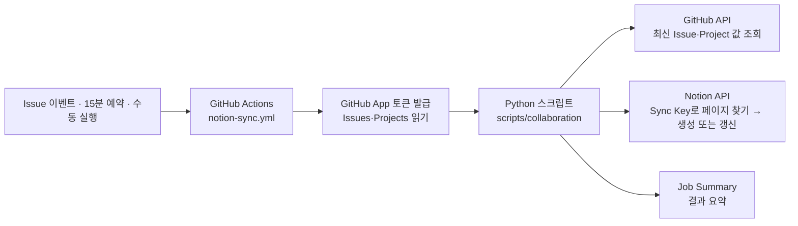

# GitHub ↔ Notion 협업 연동 가이드

**학습 목표**는 GitHub Issue와 GitHub Project "HR AX"의 진행 상태가 Notion에 어떻게 복사되는지 이해하고, 처음부터 끝까지 직접 설정·운영·중단할 수 있게 되는 것이다. 개발 경험이 없어도 순서대로 따라 할 수 있게 썼다. 코드 구조는 [작업 안내](../scripts/collaboration/README.md), 설계 근거는 [Spec](../specs/features/github-notion-sync.md)과 [ADR-003](../specs/adr/0003-github-notion-sync.md)에 있다.

> 이 가이드의 설정(GitHub App 생성, Secret 등록, Notion DB 생성, 활성화)은 모두 **사람이 직접, 팀 승인 후** 수행한다. 2026-11-25 기준 실제 연동은 아직 검증되지 않았다(NOT RUN).

## 1. 왜 연동하는가

개발 업무의 기준은 GitHub이다. Issue는 할 일, Project는 그 일이 어느 단계(Backlog → Ready → In progress → In review → Done)에 있는지 보여준다. 팀원 중 일부는 회의록과 메모를 Notion에서 관리한다. 이 연동은 GitHub 내용을 Notion 표 하나로 복사해서, Notion만 열어도 진행 상황을 볼 수 있게 한다.

- 복사 방향은 **GitHub → Notion 한 방향**이다. Notion에서 상태를 바꿔도 GitHub에는 반영되지 않는다.
- GitHub에서 온 속성을 Notion에서 바꾸면, 그 Issue가 GitHub에서 다음에 바뀔 때 GitHub 값으로 덮어쓴다(그 전까지는 바꾼 값이 남는다). 자기 메모는 `Notes` 속성이나 본문 토글 밖에 쓴다.

## 2. 기본 개념

| 용어 | 뜻 |
|---|---|
| API | 프로그램끼리 데이터를 주고받는 약속된 창구다. 여기서는 GitHub API와 Notion API를 쓴다. |
| Integration (Notion) | Notion API를 쓰는 봇 계정이다. 연결(Connections)해 준 페이지와 DB만 읽고 쓸 수 있다. |
| GitHub App | Organization이 소유하는 봇 계정이다. 허용된 권한(여기서는 Issues 읽기, Projects 읽기)만 가진 짧은 수명의 토큰을 발급한다. |
| Webhook | 이벤트가 생기면 외부 서버로 알림을 보내는 기능이다. 이 연동은 별도 서버 없이 GitHub Actions가 이벤트를 받으므로 Webhook 서버를 쓰지 않는다. |
| GitHub Actions | GitHub이 제공하는 실행 환경이다. 정해진 이벤트나 시각에 workflow 파일의 단계를 실행한다. |
| Secret / Variable | Actions에 넘기는 설정 값이다. Secret은 암호화되고 로그에 가려진다. Variable은 비밀이 아닌 설정이다. |

## 3. 전체 구조와 데이터 흐름

1. Issue가 생성·수정·Close되거나, 15분이 지나거나, 누군가 수동으로 실행하면 workflow가 시작된다.
2. workflow는 GitHub App으로 읽기 전용 토큰을 받고 Python 스크립트를 실행한다. workflow는 이벤트·권한·인증 정보·실행만 맡는다.
3. 스크립트는 이벤트에 담긴 옛 데이터를 쓰지 않는다. GitHub API에서 **지금 시점의** Issue와 Project 값을 다시 읽는다.
4. Notion에서 `Sync Key`(예: `the-first-fde/onboarding#3456789`)가 같은 페이지를 찾는다. 없으면 만들고, 있으면 바뀐 경우에만 갱신한다.
5. 결과(생성·갱신·변경 없음·건너뜀·충돌·실패)를 Actions 실행 화면의 Summary에 남긴다.

Project에서 카드만 옮기면 Issue 이벤트가 생기지 않는다. 그래서 15분마다 전체 동기화를 돌려 Project 변경을 반영한다.

## 4. Notion Integration 만들기

Notion 워크스페이스 관리자 권한이 필요하다. 협업 동기화 전용으로 새로 만들고, HR 업무용 Notion 토큰과 같이 쓰지 않는다.

1. Notion 개발자 설정 화면(https://www.notion.so/profile/integrations)에서 새 **Internal** integration을 만든다. 이름은 `GitHub Issue Sync`처럼 용도를 알 수 있게 짓는다. 화면 이름은 Notion 개편으로 달라질 수 있다. 다르면 [공식 문서](https://developers.notion.com/docs/authorization)를 확인한다.
2. 권한(Capabilities)은 **콘텐츠 읽기·수정·추가**만 켠다. 사용자 정보 읽기와 댓글 권한은 끈다.
3. 생성 후 표시되는 **Internal Integration Secret**을 복사해 9절의 Secret으로 바로 등록한다. 메모장, 채팅, 이 저장소에 붙여넣지 않는다.

실패 시: Integration 메뉴가 보이지 않으면 워크스페이스 관리자에게 생성 권한을 요청한다.

## 5. Integration 권한을 DB 하나로 제한하기

Integration은 직접 연결해 준 페이지와 그 하위만 볼 수 있다. 6절에서 만든 **GitHub Issues DB에만** 연결한다.

1. DB 페이지 오른쪽 위 `•••` → **Connections**(연결) → 4절에서 만든 Integration을 선택한다.
2. 팀 상위 페이지나 워크스페이스 전체에는 연결하지 않는다. 상위 페이지에 연결하면 하위의 회의록까지 읽을 수 있게 된다.

## 6. Notion 데이터베이스 만들기

팀 프로젝트 페이지 아래에 새 **전체 페이지 데이터베이스**를 만든다. 이름 예: `GitHub Issues`. 기존 DB를 고쳐 쓰지 않는다.

## 7. 필요한 속성 설정

**필수 속성 9개**만 만들면 동작한다. 이름과 유형을 **정확히** 맞춘다(대소문자·띄어쓰기 포함). 필수 속성이 없거나, 있는 선택 속성의 유형이 틀리면 스크립트가 쓰기 전에 멈추고 Summary에 해당 이름을 표시한다.

| 필수 속성 | 유형 | 내용 |
|---|---|---|
| (제목 속성) | 제목(Title) | Issue 제목. 이름은 상관없다. 새 DB의 기본 제목 속성(예: `이름`, `Name`)을 그대로 쓴다. |
| Sync Key | 텍스트 | 중복 방지 식별자(`owner/repo#ID`). 수정 금지 |
| Sync Hash | 텍스트 | 속성 변경 감지용. 수정 금지 |
| Body Hash | 텍스트 | 본문 변경 감지용. 수정 금지 |
| Repository | 텍스트 | `the-first-fde/onboarding`. 전체 동기화 조회에 쓴다 |
| GitHub URL | URL | 원본 링크 |
| Issue State | 선택(Select) | `Open` / `Closed` |
| Project Status | 선택 | `Backlog` / `Ready` / `In progress` / `In review` / `Done` |
| Assignees | 텍스트 | 담당자 GitHub login(쉼표 구분) |

**선택 속성**은 DB에 있을 때만 채운다. 나중에 추가해도 다음 동기화(예약 전체 동기화 포함)에서 기존 페이지까지 채워진다. 아래 **권장** 표시는 칸반·일정 관리에 쓸모가 큰 항목이다.

| 선택 속성 | 유형 | 내용 |
|---|---|---|
| Issue Number (권장) | 숫자 | Issue 번호 |
| Labels (권장) | 다중 선택 | GitHub Label |
| Milestone (권장) | 텍스트 | Milestone 제목 |
| Priority (권장) | 선택 | Organization Issue Field `Priority`(`P0`/`P1`/`P2`). Project의 `Priority` field는 쓰지 않는다 |
| Issue Type (권장) | 선택 | `Epic` / `Feature` / `Task` / `Bug` |
| Feature ID (권장) | 텍스트 | Project `Feature ID` 값(예: `F-059`) |
| Track (권장) | 선택 | Project `Track` 값 |
| Parent Issue | 텍스트 | 상위 Issue 번호(예: `#22`) |
| Sub-issues Progress | 텍스트 | `완료/전체`(하위 Issue가 없으면 빈 값) |
| Blocked By | 텍스트 | 선행 Issue 번호(예: `#43, #44`) |
| Issue Meta Sync State | 선택 | `ok` / `error`. Issue 메타데이터(Priority·Issue Type·Parent·Sub-issues·Blocked By) 조회 결과 |
| Target Date (권장) | 날짜 | Project 값 |
| Synced At (권장) | 날짜 | 마지막으로 Notion에 쓴 시각 |
| Project Sync State (권장) | 선택 | `ok` / `not_in_project` / `unmapped` / `error`. 확인이 필요한 페이지를 거를 때 쓴다 |
| Close Reason | 선택 | `completed` / `not_planned` / `duplicate` |
| Created At / Updated At | 날짜 | GitHub 생성·수정 일시 |
| Size | 선택 | Project 값 |
| Estimate | 숫자 | Project 값 |
| Start Date | 날짜 | Project 값 |

| 사람용 속성 | 유형 | 내용 |
|---|---|---|
| Notes (권장) | 텍스트 | **팀원 메모용**. 동기화가 건드리지 않는다. 이 표들에 없는 속성은 모두 같다. |

- Select 옵션은 미리 만들지 않아도 된다. 처음 쓸 때 Notion이 만든다.
- 페이지를 처음 만들 때 본문 맨 위에 토글 **"GitHub 본문 (자동 동기화 영역…)"** 이 생긴다. 토글 안쪽은 GitHub 본문이 바뀔 때마다 덮어쓴다. 회의 메모는 토글 **밖** 에 쓴다. 토글을 지우거나 제목을 바꾸면, 다음에 GitHub 본문이 바뀔 때 페이지 **끝**에 새 토글이 생긴다.
- Project Status를 Notion의 "상태(Status)" 유형이 아니라 **선택(Select)** 으로 두는 이유는 [ADR-003](../specs/adr/0003-github-notion-sync.md)에 있다.

## 8. Data Source ID 확인

Notion API 2025-09-03 이후 "데이터베이스"(그릇)와 "데이터 소스"(표)가 분리됐다. 이 연동에는 **Data Source ID**가 필요하다. Database ID를 넣으면 404 오류가 난다.

1. DB 오른쪽 위 설정(`•••`) → **Manage data sources**(데이터 소스 관리) → 해당 데이터 소스의 `•••` → **Copy data source ID**.
2. 복사한 값(32자리 16진수, 하이픈이 있을 수 있음)을 10절의 `NOTION_DATA_SOURCE_ID` Variable로 등록한다.

출처: [Notion 2025-09-03 업그레이드 가이드](https://developers.notion.com/docs/upgrade-guide-2025-09-03).

## 9. GitHub App 만들기와 Secrets 등록

기본 `GITHUB_TOKEN`은 Organization Project를 읽을 수 없다. 그래서 Organization 소유 GitHub App을 하나 만든다. **Organization Owner 권한**이 필요하다.

### 9-1. App 생성

1. GitHub에서 `the-first-fde` Organization → **Settings** → **Developer settings** → **GitHub Apps** → **New GitHub App**.
2. 입력:
   - GitHub App name: 예 `the-first-notion-sync`(전 세계에서 유일해야 한다)
   - Homepage URL: `https://github.com/the-first-fde/onboarding`
   - Webhook: **Active 체크 해제**(Actions가 이벤트를 받으므로 필요 없다)
3. Permissions:
   - Repository permissions → **Issues: Read-only**(Metadata: Read-only는 자동 포함)
   - Organization permissions → **Projects: Read-only**
   - 그 밖의 권한은 모두 No access. **쓰기 권한은 주지 않는다.**
4. Where can this GitHub App be installed? → **Only on this account**.
5. **Create GitHub App**을 누른다. 생성 화면의 **Client ID**를 기록한다(비밀 아님).

### 9-2. Private key 발급과 설치

1. 같은 App 설정 화면 아래 **Private keys** → **Generate a private key**. `.pem` 파일이 내려받아진다. 이 파일이 App의 비밀번호다.
2. 왼쪽 **Install App** → `the-first-fde` → **Only select repositories** → `onboarding`만 선택 → Install.

### 9-3. Environment와 Secrets 등록

Secret은 저장소 전체가 아니라 `main` 브랜치에서만 쓸 수 있는 **Environment**에 둔다. 누군가 다른 브랜치에 workflow를 고쳐 올려도 Secret을 받지 못하게 하기 위해서다.

1. 저장소 `the-first-fde/onboarding` → **Settings → Environments → New environment** → 이름 `notion-sync`.
2. **Deployment branches and tags** → **Selected branches and tags** → `main`만 추가한다.
3. 같은 화면의 **Environment secrets** → **Add environment secret**으로 아래 두 개를 등록한다. Repository secret에는 등록하지 않는다.

| 이름 | 값 |
|---|---|
| `NOTION_SYNC_TOKEN` | 4절의 Internal Integration Secret |
| `PROJECT_APP_PRIVATE_KEY` | `.pem` 파일 내용 전체(`-----BEGIN` 줄부터 `END-----` 줄까지) |

등록 후 내려받은 `.pem` 파일은 지운다. 저장소 폴더 안에 두지 않는다. `.gitignore`가 `*.pem`을 막지만, 실수로 다른 곳에 복사될 수 있다.

## 10. GitHub Actions Variables 등록

**Settings → Secrets and variables → Actions → Variables** 탭 → **New repository variable**.

Variable은 비밀이 아니므로 Repository variable로 둔다.

| 이름 | 값 | 설명 |
|---|---|---|
| `NOTION_SYNC_ENABLED` | 처음엔 등록하지 않거나 `false` | 정확히 `true`일 때만 실제 쓰기와 자동 실행이 켜진다 |
| `NOTION_DATA_SOURCE_ID` | 8절 값 | 동기화 대상 |
| `NOTION_SYNC_ALLOWED_ACTORS` | 팀원 GitHub login을 쉼표로, 예 `login-a,login-b,login-c` | 이 사람들이 **작성한** Issue만 동기화한다 |
| `PROJECT_NUMBER` | `1` | "HR AX" Project 번호 |
| `PROJECT_APP_CLIENT_ID` | 9-1의 Client ID | App 토큰 발급용 |

허용 목록이 비어 있으면 실제 쓰기 설정이 실패한다. Public 저장소라 외부인도 Issue를 만들 수 있기 때문이다.

## 11. GitHub Projects 추가 설정 확인

- Project 설정 → **Workflows**에서 **Auto-add to project**가 켜져 있고 필터가 `repo:the-first-fde/onboarding is:issue`류인지 확인한다. 새 Issue를 Project에 넣는 일은 이 내장 기능이 맡고, Actions는 하지 않는다.
- **Item closed** 등 Status를 바꾸는 내장 workflow가 있다. 동기화는 Project에 실제 저장된 Status만 읽는다. Issue가 Closed인데 Status가 Done이 아니면 Summary에 `state_mismatch`로 표시한다. 자동으로 고치지 않는다.
- Priority는 Organization Issue Field에서 읽는다(F-059, #90). 조회에 실패하면 `Issue Meta Sync State=error`가 되고 기존 Notion 값을 보존한다.
- Status 옵션을 추가·변경하면 그 값은 `unmapped`로 보고되고 기존 Notion 값이 유지된다. 이때 개발자가 `scripts/collaboration/github_client.py`의 `KNOWN_STATUSES`를 갱신한다(18절).

## 12. Dry-run과 수동 동기화

**어디서**: 저장소 → **Actions** 탭 → 왼쪽 **Notion Sync** → **Run workflow**. 브랜치는 반드시 `main`이다. 다른 브랜치를 고르면 job이 건너뛰어진다.

| 입력 | 의미 |
|---|---|
| `issue_number` | 비우면 전체, 숫자를 넣으면 그 Issue 하나 |
| `dry_run` | 기본 체크. Notion에 쓰지 않고 무엇을 할지만 보여준다 |

**기대 결과**: 실행이 끝나면 Summary에 `## Notion sync: dry-run (no Notion writes)`와 `created=… updated=…` 개수가 나온다. 처음이면 대부분 `created`다.

**실패하면**:
- `Configuration FAIL: missing …` → 이름이 표시된 Secret·Variable을 9·10절대로 등록한다.
- `FATAL: Notion property missing or wrong type: …` → 7절 표와 속성 이름·유형을 맞춘다. `(title)`이 표시되면 제목 유형 속성이 없는 것이다.
- `FATAL: AuthError:401…` → Notion 토큰이 틀렸거나 폐기됐다. `FATAL: ApiError:404:object_not_found` → Data Source ID가 틀렸거나 5절 연결이 빠졌다.
- `FATAL: ApiError:403:rate_limited` → GitHub API 한도 초과다. 한 시간 안에 풀린다. 인증 문제가 아니다.
- job이 회색(skipped)이면 `main`이 아닌 브랜치에서 실행했거나, Environment `notion-sync`의 브랜치 제한에 걸린 것이다.
- `project=error` → GitHub App 권한(Projects Read-only)과 설치 대상, `PROJECT_NUMBER`를 확인한다.

같은 dry-run은 `NOTION_SYNC_ENABLED`가 꺼져 있어도 실행할 수 있다. 꺼져 있으면 `dry_run`을 해제해도 쓰지 않는다.

## 13. 실제 동기화 활성화

1. 12절 dry-run이 오류 없이 끝나고, 결과 개수가 GitHub Issue 수와 맞는지 확인한다.
2. 팀 승인을 받은 뒤 Variable `NOTION_SYNC_ENABLED`를 `true`로 바꾼다.
3. **Run workflow**를 `dry_run` 해제로 한 번 실행해 전체를 만든다.
4. 이후에는 Issue 이벤트와 15분 예약 실행이 자동으로 돈다.

GitHub 예약 실행은 정확한 시각을 보장하지 않는다. 혼잡하면 수십 분 늦어지거나 한 번 건너뛸 수 있다. Public 저장소에서 60일 동안 저장소 활동이 없으면 GitHub이 예약 workflow를 자동으로 끈다. Actions 화면에서 다시 켠다.

## 14. 실행 결과 확인과 실제 연동 테스트

**결과 확인**: Actions → Notion Sync → 실행 하나 → **Summary**. Issue 번호와 결과 코드만 표시한다(Issue 내용은 공개 로그에 남기지 않는다). 빨간 X는 실패·충돌·Project 조회 문제가 있다는 뜻이다.

**실제 연동 테스트 절차**(활성화 직후 한 번):

1. 허용 목록에 있는 팀원이 테스트 Issue를 만든다 → 1~2분 안에 Notion 페이지가 생기는지 본다.
2. 제목·Label·담당자·Milestone을 바꾼다 → 해당 속성이 바뀌는지 본다.
3. Notion 페이지의 `Notes`와 토글 밖에 메모를 쓰고, GitHub 본문을 수정한다 → 메모가 남고 토글 안만 바뀌는지 본다.
4. Project에서 카드를 `In progress`로 옮긴다 → 15분 안팎(또는 수동 전체 실행) 뒤 `Project Status`가 바뀌는지 본다.
5. Issue를 Close → `Issue State=Closed`, Project Status는 Project 값 그대로인지 본다. Reopen → `Open`으로 돌아오는지 본다.
6. 허용 목록 밖 계정으로 Issue를 만든다 → Notion에 생기지 않고 Summary에 `skipped`가 나오는지 본다.
7. Project에서 빼낸 Issue의 `Project Status`가 비워지는지 본다(Notion이 Select 비우기를 받는지 실제 API로 확인하는 항목).
8. 결과를 PR 또는 팀 채널에 PASS/FAIL로 기록하고 테스트 Issue를 정리한다.

## 15. Notion 칸반 보드와 담당자별 View

- **칸반**: DB 상단 `+ 보기 추가` → **보드** → 그룹 기준 `Project Status`. 열 순서를 Backlog → Ready → In progress → In review → Done으로 맞춘다. 여기서 카드를 옮겨도 GitHub에는 반영되지 않는다. 그 Issue나 Project 값이 GitHub에서 다음에 바뀔 때 GitHub 값으로 돌아온다. 상태는 GitHub Project에서 옮긴다.
- **담당자별**: 표 보기 → 필터 `Assignees` **포함** `내 GitHub login`. 사람마다 보기를 하나씩 만든다.
- **열린 일만**: 필터 `Issue State` = `Open`.
- **확인 필요**: 필터 `Project Sync State` ≠ `ok`(선택 속성을 추가한 경우).

## 16. 오류와 중복 해결

| 증상 | 원인과 조치 |
|---|---|
| Summary `conflict … duplicate_pages` | 같은 `Sync Key` 페이지가 2개 이상이다. 자동 삭제하지 않는다. 메모가 없는 쪽을 사람이 지우고 수동 실행한다. |
| `failed … ApiError:400:validation_error` | 속성 값이 Notion 제한(긴 텍스트·옵션 쉼표 등)에 걸렸다. Issue 번호로 내용을 확인하고 Issue를 고친다. 반복되면 개발자에게 Issue를 남긴다. |
| `failed … UncertainWriteError` | 쓰기 응답이 끊겨 반영 여부를 확인하지 못했다. 중복을 막기 위해 다시 만들지 않는다. 다음 실행이 다시 조회해 맞춘다. 그래도 중복이 생기면 위 conflict 절차를 따른다. |
| `failed … unexpected_response` / `FATAL: unexpected_response` | API 응답 형태가 예상과 다르다. API 버전 변경 가능성이 있으니 개발자에게 Issue를 남긴다. |
| `pages with unexpected Sync Key: N` | 누군가 Notion에서 `Sync Key`를 고쳤거나 수동으로 페이지를 만들었다. 값은 공개 로그에 쓰지 않고 개수만 표시한다. Notion에서 찾아 고친다. |
| `ApiError:429:rate_limited` 반복 | Notion 요청 한도(일반 플랜 초당 약 3회)에 걸렸다. 스크립트가 기다렸다 재시도하지만, 계속되면 예약 주기를 늘린다. |
| `orphan page (no GitHub issue)` | GitHub에서 Issue가 삭제되거나 다른 저장소로 옮겨졌다. Notion 페이지는 자동 삭제하지 않는다. 필요 없으면 사람이 지운다. |
| `project=unmapped` | Project Status에 새 옵션이 생겼다. 11절 마지막 항목대로 갱신한다. |
| `state_mismatch` | Close됐는데 Done이 아니거나 그 반대다. 정보 표시이며 실패가 아니다. 팀이 Project 카드를 정리한다. |

## 17. 동기화 중단과 인증 정보 폐기

- **바로 멈추기**: Variable `NOTION_SYNC_ENABLED`를 `false`로 바꾼다. Issue 이벤트·예약 실행이 건너뛰어진다. 완전히 멈추려면 Actions → Notion Sync → `•••` → **Disable workflow**.
- **Notion 토큰 폐기**: Notion Integration 설정에서 Secret을 재발급하거나 Integration을 삭제한다. 이어서 GitHub Secret `NOTION_SYNC_TOKEN`을 새 값으로 바꾸거나 삭제한다.
- **GitHub App 폐기**: App 설정 → Private keys에서 키를 **Delete**하고 Secret `PROJECT_APP_PRIVATE_KEY`를 지운다. 완전히 끊으려면 Organization Settings → GitHub Apps → 해당 App **Uninstall** 또는 **Suspend**.
- **남는 위험**: GitHub App의 Projects 읽기 권한은 Project 하나로 좁힐 수 없어 Organization의 다른 Project도 읽을 수 있다. Notion Integration은 연결된 범위의 블록을 지울 수 있다. 그래서 App key와 Notion 토큰은 분기마다 교체하고, Integration은 5절대로 DB 하나에만 연결한다.
- 토큰이 노출됐다고 의심되면 토큰을 즉시 폐기·재발급하고 GitHub Secret을 교체한다. 값을 채팅이나 Issue에 붙여 확인하지 않는다.

## 18. Claude Code로 유지보수하기

착수 전에 [작업 안내](../scripts/collaboration/README.md)와 같은 폴더의 CLAUDE.md를 읽게 한다. 예시 요청:

- “Project에 `Blocked` Status가 추가됐어. /plan-task로 `KNOWN_STATUSES`와 테스트 변경 계획을 보여줘.”
- “Notion에 `Sprint` 속성을 추가하고 Milestone을 넣고 싶어. Spec·ADR 표를 먼저 고치는 계획을 세워줘.”
- “Summary에 `failed #12 ApiError:400:validation_error`가 나왔어. /review-changes 없이 원인 후보와 재현 테스트만 제안해줘.”

Claude에게 실제 토큰 값을 주지 않는다. 실제 실행은 사람이 Actions에서 하고, Claude에게는 Summary 결과 코드만 전달한다.

## 19. 현재 제한과 확장 범위

- 제한: Notion → GitHub 쓰기, 양방향 동기화, PR 동기화, 알림, Issue 삭제·이동 자동 처리는 하지 않는다. 본문은 Markdown 서식 없이 문단 텍스트로 보인다. 긴 본문은 일부만 보이고 원문 링크가 붙는다.
- 확장할 때(새 Spec 필요): PR DB 추가, Notion 사용자(Person) 매핑, Markdown 서식 표시. 기존 책임 분리(workflow / client / sync)를 유지한 채 해당 모듈만 늘린다.

## 20. 공식 문서

- [Notion API 버전](https://developers.notion.com/reference/versioning) · [요청 한도](https://developers.notion.com/reference/request-limits) · [Data Source 업그레이드 가이드](https://developers.notion.com/docs/upgrade-guide-2025-09-03) · [Authorization](https://developers.notion.com/docs/authorization)
- [GitHub Actions 이벤트(issues, schedule, workflow_dispatch)](https://docs.github.com/en/actions/reference/workflows-and-actions/events-that-trigger-workflows) · [Secrets](https://docs.github.com/en/actions/how-tos/write-workflows/choose-what-workflows-do/use-secrets) · [Variables](https://docs.github.com/en/actions/how-tos/write-workflows/choose-what-workflows-do/use-variables)
- [GitHub App 만들기](https://docs.github.com/en/apps/creating-github-apps/registering-a-github-app/registering-a-github-app) · [create-github-app-token](https://github.com/actions/create-github-app-token) · [Projects API](https://docs.github.com/en/issues/planning-and-tracking-with-projects/automating-your-project/using-the-api-to-manage-projects) · [Project 내장 자동화](https://docs.github.com/en/issues/planning-and-tracking-with-projects/automating-your-project/using-the-built-in-automations)

- [ ] dry-run과 실제 실행의 차이, 쓰기가 켜지는 조건을 설명한다.
- [ ] 토큰을 폐기하고 동기화를 멈추는 순서를 안다.
