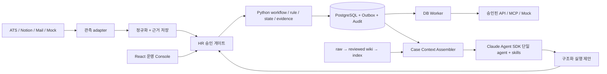

# Hybrid Architecture

Modular monolith다. FastAPI는 입력/인증/조회, Pydantic은 extra=forbid 계약,
SQLAlchemy는 트랜잭션과 제약, Alembic은 스키마, PostgreSQL은 진실의 원천이다.
LangChain은 문서 적재·검색 파이프라인에만 사용하고 업무 흐름을 제어하지 않는다.
pgvector의 유사도보다 권한·유효기간·review 상태 필터를 먼저 적용한다.

## 책임과 내구성
API의 승인 액터는 서버에서 결정한다. body의 hr_approved=true 같은 자체 선언은 인정하지 않는다.
HireConfirmedEvent, case, outbox, audit는 같은 트랜잭션으로 저장한다.
유일성: (candidate_id, onboarding), event_id, (case_id, action_type). 동일 키 다른 payload는 409다.
worker는 pending을 잠그고 mock receipt와 성공 상태를 같은 트랜잭션에 기록한다.
실연동 시에는 lease/skip locked, 지수 backoff, DLQ, 수신처 idempotency key, crash 재처리 검증이 필요하다.
현재 worker는 단일 프로세스 단발/반복 실행이며 외부 side effect를 하지 않는다.

## 모델 확장 계획
candidate / employee / hr_case / workflow_template / task_template / task_instance /
source_event / evidence_record / task_evidence_link / agent_finding / action_proposal /
approval / execution_log / workflow_run / knowledge_document / audit_log.
현재 DB는 handoff_event, onboarding_case, outbox, mock_receipt, audit_record만 구현했다.

## 상태와 시각
업무: PENDING → IN_PROGRESS → EVIDENCE_FOUND → COMPLETED 또는 NEEDS_REVIEW; BLOCKED는 별도 복구 경로.
증거 상태와 실행 상태를 분리하고 OVERDUE는 due_at 대비 파생 속성으로 둔다.
occurred_at(실제 사건), observed_at(발견), verified_at(검증), completed_at(확인된 실제 완료)을 분리한다.
정책은 effective_from, recorded_at, version을 가져 replay에 미래 지식이 섞이지 않게 한다.

## 보안과 운영 목표
LLM 입력은 가명 case id, 허용 필드, 근거 참조만. 자유문은 정제 승인 전 금지한다.
Hook/permission은 보조 방어이며 실행 gateway가 최종 권한을 검사한다.
agent의 shell/file/network 임의 도구는 제공하지 않는다. tenant/case/role 필터는 저장소 조회 전에 적용한다.
run_id/trace_id, action_id, policy_version, token/cost 집계는 설계 대상이며 mock receipt 외 추적은 미구현이다.
초기 한도는 제품 제안값: 10 tool calls / 60초 / 2 재시도 / run당 $0.50. 회사 정책으로 간주하지 않는다.
